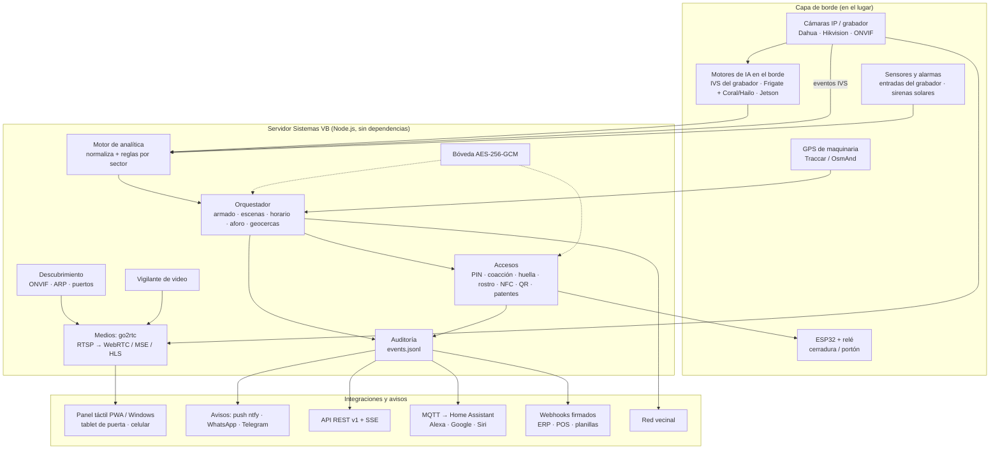
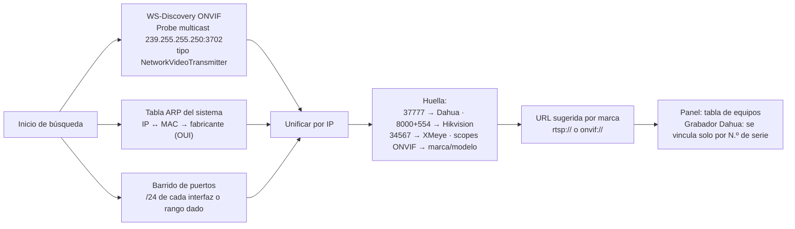
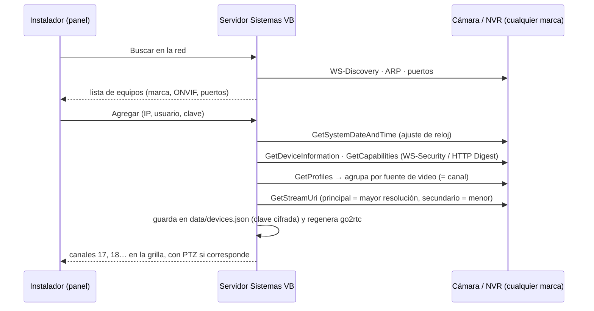
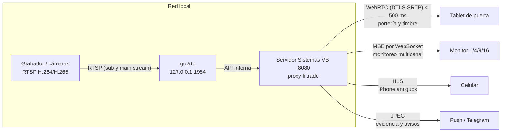
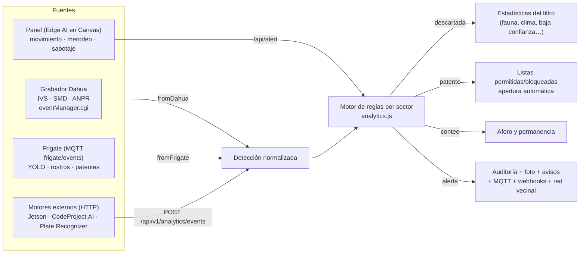
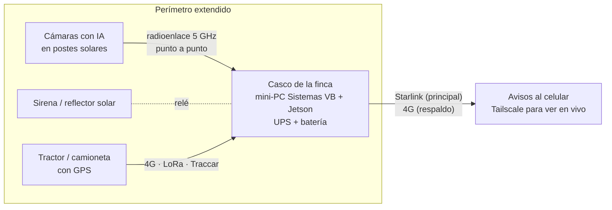
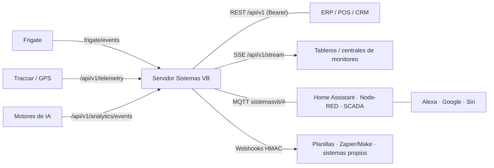

# Sistemas VB Seguridad Integral — Arquitectura técnica

**Sistema de Seguridad Integral Unificado** para comercios, industrias y empresas, campos y fincas, y hogares.
Versión 2.1 · Producto genérico (sin datos de clientes).

Desarrollado por **Vincular Business · Sistema VB** — WhatsApp (387) 4484132 · vincularbusiness@gmail.com

---

## 0. Resumen

Sistemas VB Seguridad Integral se apoya en una base probada en instalaciones reales (accesos, visitantes, timbre QR/NFC, cerradura ESP32, huella y rostro, avisos push/WhatsApp/Telegram, firmware) y le suma una **plataforma multi-sector** con cinco ideas que lo separan de un DVR/NVR común:

1. **Una sola puerta de entrada para toda la inteligencia artificial.** No importa si la detección viene del grabador Dahua, de Frigate o de un Jetson en el campo: todo se normaliza a un único formato y pasa por el mismo motor de reglas.
2. **Reglas por sector.** El mismo software se comporta distinto en un almacén (aforo, permanencia), en una planta (EPP, caídas), en un campo (filtra fauna y clima) o en una casa (escenas, pánico, red vecinal).
3. **Funciona sin internet y sin nube.** Todo corre en una PC, mini-PC o Raspberry Pi del lugar; internet solo se usa para avisar. Si se corta, los avisos críticos se reintentan 15 minutos.
4. **Abierto a otros sistemas.** API REST con tokens y permisos, eventos en vivo (SSE), MQTT con autodescubrimiento en Home Assistant (y desde ahí Alexa, Google y Siri), webhooks firmados para ERP/POS.
5. **Privacidad por diseño.** Credenciales y plantillas biométricas cifradas con AES-256-GCM; de los rostros solo se guarda un vector numérico, nunca fotos; la coacción y el pánico no dejan rastro en la pantalla de la puerta.

Estado de cada pieza: **✅ implementado y probado en v2.0** · **🔌 se integra con un motor/equipo externo ya soportado** · **🗺 hoja de ruta**.

---

## 1. Vista general de capas



### Stack tecnológico

| Capa | Tecnología | Por qué |
|---|---|---|
| Servidor | **Node.js ≥ 18, sin dependencias npm** | Se instala con doble clic, corre en Windows, Linux y Raspberry Pi; superficie de ataque mínima (no hay árbol de paquetes que auditar). |
| Medios | **go2rtc** (binario único) | RTSP/RTMP/ONVIF/HTTP de entrada; WebRTC, MSE, HLS, MJPEG de salida; transcodifica con FFmpeg solo cuando hace falta. Alternativa equivalente: **MediaMTX**. |
| Panel | **HTML5 + CSS + JavaScript nativo en un solo archivo**, PWA, Electron para Windows | Funciona en tablet de pared, celular, tótem o PC; sigue abriendo sin servidor (modo autónomo). |
| IA en el borde | Eventos IVS del grabador Dahua · **Frigate 0.16+** (detección YOLO, reconocimiento facial y de patentes) con Coral TPU / Hailo-8 / GPU · **NVIDIA Jetson Orin** para campo e industria | Se usa lo que el cliente ya tiene; se suma potencia solo donde se necesita. |
| Rostro en el panel | face-api (TensorFlow.js, MIT) con prueba de vida por parpadeo | Biometría local, sin servicios pagos. |
| Cerradura | ESP32 + relé, firmware propio con vínculo automático | Hardware de USD 10; abre aunque se corte internet. |
| Mensajería | **MQTT 3.1.1** (cliente propio), **SSE**, **webhooks HMAC-SHA256** | Estándares que entienden Home Assistant, Node-RED, SCADA y cualquier ERP. |
| Avisos | ntfy (push con foto y botones), CallMeBot (WhatsApp), Telegram Bot API | Gratis, sin abrir puertos del router. |
| Acceso remoto | **Tailscale / WireGuard** (o Caddy con HTTPS) | Nunca se abren puertos al exterior. |
| Cifrado | AES-256-GCM (Node `crypto`), scrypt para PINs, SHA-256 para tokens | Primitivas estándar, sin criptografía propia. |

---

## 2. Descubrimiento y video en vivo

### 2.1 Motor de autodescubrimiento ✅

Archivo: `server/lib/onvif.js` (multi-marca) + `server/lib/discover.js` (grabador Dahua por número de serie).



- **ONVIF WS-Discovery**: se envía el *Probe* dos veces (UDP se pierde en WiFi). De cada *ProbeMatch* se extraen `XAddrs`, UUID, nombre, hardware, ubicación y perfiles anunciados (**S** streaming, **G** grabación, **T** H.265/eventos avanzados).
- **ARP**: Linux lee `/proc/net/arp`; Windows/macOS usan `arp -a`. El prefijo OUI de la MAC da el fabricante probable (Hikvision, Dahua, Axis, Reolink, ESP32).
- **Puertos**: 554 RTSP, 80/8080 HTTP, 8000 SDK Hikvision, 37777 Dahua, 34567 XMeye, 1935 RTMP, 8899 ONVIF alternativo. Primero 554/80; el resto solo si el equipo respondió (rápido en redes grandes).
- **Respaldo**: rango manual (`CAM_SCAN=192.168.1.0/24` o lista de IPs).
- **Dahua de DMSS**: con `CAM_HOST=auto` se encuentra el grabador cuyo número de serie coincide con el de la app DMSS (Digest auth), y se recuerda la última IP para arrancar rápido.
- 🗺 **mDNS/Bonjour** (`_rtsp._tcp`, `_http._tcp`) para cámaras de consumo que no hablan ONVIF.

Plantillas de URL por marca: Dahua `…/cam/realmonitor?channel=1&subtype=0`, Hikvision `…/Streaming/Channels/101`, Uniview `…/unicast/c1/s0/live`, Axis `…/axis-media/media.amp`, Reolink `…/h264Preview_01_main`, XMeye `…/user=…&password=…&channel=1&stream=0.sdp`, genérica `onvif://usuario:clave@ip:puerto`.

### 2.1 bis Inventario de equipos y alta con un botón ✅

Archivos: `server/lib/onvif-client.js`, `server/lib/devices.js` · Pantalla: Admin → **Equipos y cámaras** y el **asistente de instalación**.



- Tres formas de alta: **ONVIF** (automática), **por marca** sin ONVIF (plantillas Dahua, Hikvision, Uniview, Axis, Reolink, XMeye + cantidad de canales) y **por URL RTSP**.
- Los canales del inventario reciben un número global estable desde el **17** (del 1 al 16 quedan para el grabador Dahua principal configurado por número de serie). go2rtc los publica como `svb_ch<N>` y `svb_ch<N>_hd`.
- **PTZ por ONVIF** (ContinuousMove / Stop) con el perfil principal de cada canal motorizado; el panel muestra el botón PTZ solo en esas cámaras.
- Claves de los equipos cifradas con la bóveda AES-256-GCM cuando `SECRETS_ENCRYPT=1`.

### 2.1 ter Asistente de instalación y perfiles de pantalla ✅

- **Asistente** (6 pasos, se abre solo la primera vez que se entra a Administración): negocio y sector → PINs propios (obligatorio) → cámaras (buscar y agregar) → cerradura ESP32 → avisos → resumen. Estado en `GET/POST /api/v1/wizard`.
- **Perfil de pantalla automático** según el dispositivo: puntero táctil + pantalla chica = **celular**; táctil = **tablet de pared / tótem**; mouse = **PC de administración**; `?pantalla=monitor` = **monitor de cámaras** (solo grilla, para televisores fijos). Se puede forzar en Admin → Sistema.
- **Periféricos detectados** en el equipo del panel: cámaras, micrófonos, parlante, USB serie (cerradura por cable), NFC, huella/passkeys, reconocimiento de voz, pantalla táctil y lector QR USB/Bluetooth (se reconoce por la velocidad de tipeo).

### 2.2 Pipeline de streaming ✅



- **Ingesta**: RTSP del grabador (sub-stream liviano para grillas, main-stream para pantalla completa y evidencia). RTMP y ONVIF también aceptados por go2rtc.
- **Entrega**:
  - **WebRTC** para portería y timbre: latencia típica 200–500 ms en la red local (puerto 8555 UDP/TCP).
  - **MSE por WebSocket** para el monitor multicanal: atraviesa proxies y Tailscale sin configurar STUN/TURN.
  - **HLS** solo como respaldo para Safari antiguo.
- **Transcodificación al vuelo**: go2rtc remultiplexa sin recodificar siempre que el navegador soporta el códec; FFmpeg se usa para H.265 → H.264 o para fotos JPEG.
- **Seguridad del proxy**: go2rtc escucha solo en `127.0.0.1`; el servidor deja pasar únicamente los endpoints de video y bloquea `/api/config` y `/api/streams` (contienen contraseñas RTSP).

### 2.3 Resiliencia ✅

| Problema | Mecanismo |
|---|---|
| go2rtc se cierra | Reinicio automático con espera creciente (2 s → 30 s). |
| go2rtc queda colgado (no responde pero el proceso vive) | **Vigilante de video** cada 20 s: 3 fallas seguidas de la API → reinicio y evento `VIDEO_SERVER_RESTART`. |
| Se corta una cámara | El vigilante mira solo las cámaras con alguien mirando; 3 controles sin productor → `STREAM_DOWN`, y `STREAM_RECOVERED` cuando vuelve. Además el grabador informa `VideoLoss`. |
| WiFi congestionado | Grilla en sub-stream, HD solo al ampliar; el reproductor reconecta solo; WebRTC cae a MSE automáticamente. |
| Ancho de banda limitado (campo, 4G, satelital) | Grilla en sub-stream, avisos con foto JPEG en lugar de video, acceso remoto por Tailscale (directo P2P, sin pasar por servidores). |
| Cambia la IP del grabador | Se busca de nuevo por número de serie. |
| Se cae el servidor | El panel sigue en **modo autónomo**: PINs de respaldo, cámara local, portero y avisos directos desde la tablet. |
| Se corta internet | Avisos críticos (timbre, SOS, coacción, alarmas) en cola de reintento 15 minutos. |

---

## 3. Inteligencia artificial y analítica de video

### 3.1 Principio: el borde detecta, el servidor decide ✅



Formato normalizado (todas las fuentes terminan así):

```json
{
  "source": "dahua | frigate | api",
  "kind": "person | vehicle | animal | plate | ppe | fall | immobile | running | loitering | crowd | intrusion | line | speed | wrongway | count | dwell | face | tamper | fire | smoke | sign",
  "label": "car",
  "camera": "Portón",
  "channel": 2,
  "confidence": 0.92,
  "plate": "AB123CD",
  "speed": 30,
  "direction": "salida",
  "zone": "Playa de carga",
  "missing": ["casco", "chaleco"],
  "count": 12,
  "delta": 1,
  "seconds": 340,
  "text": "TRANSPORTES DEL NORTE",
  "attrs": { "vehicle": "Camión", "color": "Blanco", "brand": "Mercedes-Benz" }
}
```

### 3.2 Analítica vehicular

| Función | Estado | Cómo |
|---|---|---|
| Lectura de patentes (ALPR/ANPR) | ✅ reglas · 🔌 lectura | Cámaras ANPR Dahua (`TrafficJunction`), Frigate 0.16+ (LPR), o cualquier OCR por API. El servidor normaliza (`AB 123 CD` → `AB123CD`), reconoce formato argentino (Mercosur, 1995, moto) y compara con listas. |
| Tolerancia a errores de OCR | ✅ | Forma canónica (0/O/D/Q, 1/I/L, 8/B, 5/S, 2/Z, 6/G). Una lectura "parecida" **nunca abre**; sí dispara la alerta si se parece a una bloqueada. |
| Apertura de portón por patente | ✅ | Solo lectura exacta, solo patente autorizada, solo en horario (o marcada "fuera de horario"), relé del ESP32. Recomendado combinar con un segundo factor en alta seguridad: una patente se puede falsificar. |
| Tipo / color / marca de vehículo | 🔌 | Atributos que entrega la cámara ANPR o el modelo (`attrs.vehicle`, `color`, `brand`). |
| Rotulación de puertas / cartelería | 🔌 | `kind: "sign"` con el texto leído (OCR tipo PaddleOCR en Jetson/Frigate). Se registra como `SIGN_READ` y se puede cruzar con proveedores esperados. |
| Exceso de velocidad / contramano | ✅ reglas · 🔌 medición | `TrafficOverSpeed`, `TrafficRetrograde` de Dahua o `kind: speed/wrongway`. Límite configurable (`SPEED_LIMIT`). |

### 3.3 Percepción conductual y biometría

| Función | Estado | Detalle |
|---|---|---|
| Reconocimiento facial del personal | ✅ | face-api en el panel; en el servidor solo se compara la plantilla (128 números), nunca se guardan fotos. |
| Prueba de vida (liveness) | ✅ activa · 🗺 pasiva | Activa: parpadeo obligatorio. Pasiva (textura/profundidad, anti-pantalla) en hoja de ruta con un modelo anti-spoofing en el borde. Para alta seguridad: huella (passkey WebAuthn) que el servidor verifica con firma criptográfica. |
| Caídas e inmovilidad | ✅ reglas · 🔌 detección | `FallDetection`/`ManStandDetection` de Dahua o `kind: fall/immobile` desde un modelo de pose (YOLO-Pose). Alerta `HIGH` con foto. |
| Carrera repentina | ✅ | `MoveDetection` / `kind: running`; avisa con el sistema armado. |
| Merodeo | ✅ | Panel (presencia > N s sin interactuar) + `WanderDetection`/`StayDetection` del grabador. |
| Aglomeraciones | ✅ | `RioterDetection`/`CrowdDetection` o `kind: crowd` con `count ≥ CROWD_MIN`. |
| EPP (casco, chaleco, botas, guantes, anteojos) | ✅ reglas · 🔌 detección | Modelo YOLO de EPP en Frigate/Jetson envía `kind: ppe` con `missing`. En sector industria siempre avisa. |
| Fuego y humo | ✅ | Alerta `CRITICAL` + red vecinal. |
| Sabotaje de cámara | ✅ | Panel (lente tapado/cegado) + `VideoBlind` del grabador (avisa siempre, aunque esté desarmado). |

### 3.4 Filtro inteligente para campos ✅

Activo siempre en sector **campo** (o con `RURAL_FILTER=1` en cualquier sector):

1. **Movimiento sin clasificar no avisa.** El `VideoMotion` del grabador (sombras, ramas, insectos, lluvia) se descarta; solo cuentan personas, vehículos, intrusiones y cruces de línea clasificados.
2. **Fauna.** Vacas, caballos, perros, aves, zorros, liebres, pumas, etc. se descartan por etiqueta.
3. **Confianza mínima** configurable (`ANALYTICS_MIN_CONF`, 55 % por defecto).
4. **Persistencia.** Hacen falta N detecciones de la misma clase en la misma cámara dentro de una ventana (2 en 10 s por defecto). Una detección de confianza ≥ 85 % pasa directo.
5. **Clima y vegetación.** Si una cámara acumula ≥ 12 detecciones dudosas por minuto (confianza media < 60 %), se interpreta como viento/lluvia/vegetación: se pausan 5 minutos las de baja confianza y se registra `ANALYTICS_NOISE` una sola vez.
6. Cada descarte queda contado por motivo (`/api/v1/analytics/recent` y la pantalla de Integraciones), para ajustar con datos y no a ojo.

---

## 4. Adaptación por sector y automatización

Se elige en ★ Configuración → **Sector e inteligencia artificial** (`SECTOR=`). Cambia reglas, avisos, el perfil del panel y los módulos visibles.

| | Comercio | Industria / empresa | Campo / finca | Hogar |
|---|---|---|---|---|
| Perfil del panel | alta seguridad | alta seguridad | alta seguridad | doméstico |
| Aforo y permanencia | ✅ | ✅ | — | — |
| Pases QR/NFC con vencimiento y usos | ✅ | ✅ | ✅ | ✅ |
| EPP, caídas, velocidad | opcional | ✅ siempre avisa | opcional | — |
| Filtro de fauna y clima | opcional | opcional | ✅ siempre | opcional |
| Patentes / portón | ✅ | ✅ | ✅ | ✅ |
| Geocercas de maquinaria | — | opcional | ✅ | — |
| Escenas en pantalla (Llegué / Noche / Salgo) | — | — | — | ✅ |
| Red vecinal | opcional | opcional | ✅ recomendada | ✅ recomendada |

### 4.1 Campos y fincas



- **Conectividad resiliente**: Starlink como enlace principal y router 4G/LTE de respaldo con *failover* automático; radioenlaces 5 GHz punto a punto o punto-multipunto para cámaras lejanas del casco. Todo el análisis ocurre en el casco: por el enlace satelital solo viajan avisos con foto (pocos KB). El video en vivo se ve bajo demanda por Tailscale.
- **Energía**: cámaras y radios en postes con panel solar + batería LiFePO4 dimensionada para 3 días nublados; servidor con UPS. Hoy se detecta la pérdida de video de cada cámara (vigilante + `VideoLoss`); 🗺 medición de tensión de baterías y aviso de corte de energía con un ESP32.
- **Geocercas** ✅: cada activo (tractor, cosechadora, camioneta) envía su posición por `POST /api/v1/telemetry` o por GET al estilo OsmAnd (la app gratuita *Traccar Client* lo hace sin configurar nada más). Modo *inside* avisa al **salir** del lote; modo *outside* avisa al **entrar** a una zona prohibida. Aviso con enlace a Google Maps.
- **Alertas perimetrales solares**: sirena/reflector controlados por un segundo ESP32 (mismo firmware de relé) o por las salidas de alarma del grabador.

### 4.2 Comercios e industrias

- **Aforo dinámico** ✅: contador por API (molinete, contador de cámara, botón del panel), alerta al llegar al máximo (`OCCUPANCY_FULL`), pico del día, entradas/salidas, reinicio diario automático. Visible en el encabezado del panel, en Home Assistant y en Telegram (`/aforo`).
- **Tiempos de permanencia** ✅: el motor recibe `kind: dwell` (seguimiento de Frigate o del modelo) y calcula promedio, percentil 90 y máximo por 24 h.
- **Visitas con QR temporal autorregulado** ✅: código de 6 dígitos con vencimiento y cantidad de usos; se bloquea fuera de horario; se envía por WhatsApp y se lee por cámara, lector USB/Bluetooth, NFC o teclado.
- **Auditoría vinculada a la apertura** ✅: cada accionamiento del relé queda con quién (persona, token, patente, visita), por qué medio (PIN, huella, rostro, NFC, QR, API, MQTT), hora y, si corresponde, foto. Exportable a JSON y CSV.

### 4.3 Hogares

- **Asistentes de voz** ✅: el servidor se publica solo en **Home Assistant** (MQTT discovery): interruptor *Sistema armado*, sensores de modo noche, horario, aforo y último evento, y botones *Llegué a casa*, *Modo noche* y *Salgo*. Desde Home Assistant se exponen a **Alexa** y **Google Assistant** (Home Assistant Cloud o integración manual) y a **Siri** (puente HomeKit). Además el panel trae su propio asistente de voz en español sin servicios pagos.
- **Escenas** ✅: *Llegué a casa* (desarma), *Salgo* (arma), *Modo noche* (arma + visión nocturna en todos los paneles), *Modo día*. Desde la pantalla (con PIN), voz (pide PIN), Telegram (`/llegue`, `/noche`, `/salgo`), Home Assistant o la API.
- **Pánico silencioso** ✅: no cambia nada en pantalla; avisa a todos los dueños con foto y a la red vecinal. Se dispara por API, Home Assistant o el PIN de coacción (también si se usa para una escena: la escena se ejecuta normal y el aviso sale en silencio).
- **Red de alerta comunitaria** ✅: los vecinos/comercios que comparten un código reciben en su panel y en su celular los SOS, pánicos, fuego e intrusiones confirmadas del resto, más avisos manuales ("auto sospechoso dando vueltas"). Viaja por un relevo ntfy; cada nodo ignora sus propios mensajes.

---

## 5. Seguridad, privacidad e interoperabilidad

### 5.1 Seguridad y privacidad

| Dato / canal | Protección |
|---|---|
| Video en la red local | Cámaras en VLAN o red separada recomendada. go2rtc solo en `127.0.0.1`. |
| Video hacia los paneles | WebRTC cifrado de fábrica (DTLS-SRTP). MSE/HLS cifrados con TLS al usar `https://` (Tailscale Serve o Caddy). |
| Acceso remoto | Tailscale / WireGuard (cifrado punto a punto, sin abrir puertos). |
| MQTT | `mqtts://` con TLS y usuario/clave. Abrir la puerta por MQTT apagado por defecto; si se activa, exige el PIN dentro del mensaje y tiene bloqueo por intentos. |
| Credenciales en disco (`.env`) | ✅ AES-256-GCM (`SECRETS_ENCRYPT=1`): contraseñas de grabador, tokens, claves de WhatsApp y MQTT quedan como `enc:v1:…`. Clave maestra en `data/master.key` (permisos 600) o en la variable `SVB_MASTER_KEY`. |
| Datos biométricos y PINs | ✅ PINs con scrypt + sal; rostros como vector de 128 números (sin fotos); passkeys con clave pública. El archivo completo `access.json` se cifra con AES-256-GCM. Se borran al retirar el consentimiento. |
| Tokens de API | ✅ Se muestran una sola vez; en disco solo el hash SHA-256. Permisos `read` / `control` / `ingest`; revocables. Solo por encabezado `Authorization`, salvo `/api/v1/telemetry` (las apps GPS no envían encabezados). Un token `ingest` con la apertura por patente activada puede abrir el portón informando una patente autorizada: entregarlo solo a motores de IA de confianza. |
| Webhooks | ✅ Firma HMAC-SHA256 sobre `timestamp.cuerpo`, rechazo de mensajes de más de 5 minutos, sin IPs internas en el contenido. |
| PINs por la red | Validación en el servidor, comparación en tiempo constante, bloqueo de 60 s tras 5 errores, aviso al dueño. |
| Coacción y pánico | Respuesta idéntica a una apertura normal; el panel de la puerta no recibe esos eventos (van solo a dueños, API, MQTT y webhooks). |
| Repositorio público | Nunca se suben `.env`, `data/` ni credenciales (`.gitignore`); el servidor no publica esos archivos por HTTP. |

### 5.2 Ecosistema de integración



---

## 6. Endpoints

Autenticación de la API v1: `Authorization: Bearer svb_…` (token creado en Administración → Integraciones y analítica) o encabezado `X-Admin-Pin`. Especificación completa y siempre actualizada en **`GET /api/v1/openapi.json`** (OpenAPI 3).

| Método | Ruta | Permiso | Uso |
|---|---|---|---|
| GET | `/api/v1` | público | Producto, versión, desarrollador |
| GET | `/api/v1/openapi.json` | público | Especificación OpenAPI |
| GET | `/api/v1/health` | público / read | Salud por componente (video, grabador, cerradura, portero, MQTT, webhooks, vecinal, cifrado) |
| GET | `/api/v1/sectors` | público | Perfiles y módulos |
| GET | `/api/v1/status` | read | Armado, noche, horario, aforo, cámaras, integraciones, estadísticas de IA |
| GET | `/api/v1/events?limit&since&level&type` | read | Auditoría filtrable |
| GET | `/api/v1/stream` | read | Eventos en vivo (SSE): `event`, `analytics`, `arm`, `scene`, `occupancy`, `ring`, `dvr`, `geofence`, `community`, `stream` |
| POST | `/api/v1/arm` | control | `{ "armed": true }` |
| GET | `/api/v1/scenes` | read | Escenas disponibles |
| POST | `/api/v1/scenes/{llegada\|salida\|noche\|dia\|panico}` | control o PIN | Ejecuta la escena |
| POST | `/api/v1/door/open` | control | `{ "ms": 3000, "reason": "Proveedor X" }` |
| GET / POST | `/api/v1/occupancy` | read / control·ingest | `{ "delta": 1 }` o `{ "set": 12 }` |
| POST | `/api/v1/analytics/events` | ingest | Una detección o `{ "events": [...] }` (hasta 50), foto opcional `snapshot` en base64 JPEG |
| GET | `/api/v1/analytics/recent` | read | Últimas detecciones y motivos de descarte |
| GET / POST / DELETE | `/api/v1/plates` | read / admin | Listas de patentes |
| GET / POST / DELETE | `/api/v1/geofences` | read / admin | Geocercas y posiciones |
| POST / GET | `/api/v1/telemetry` | ingest | `{ id, name, lat, lng, speed }` o `?id=&lat=&lon=&token=` |
| GET / POST | `/api/v1/community` | read / admin | Red vecinal |
| GET / POST / DELETE | `/api/v1/tokens` | admin | Tokens de API |
| POST | `/api/v1/discovery` | admin | Descubrimiento multi-marca `{ "scan": "192.168.1.0/24" }` |
| POST | `/api/v1/webhooks/test` | admin | Prueba de webhooks |
| GET | `/api/v1/devices` | read | Equipos de video del inventario (sin claves) |
| POST | `/api/v1/devices/probe` | admin | Consultar un equipo por ONVIF sin agregarlo |
| POST | `/api/v1/devices` | admin | Agregar equipo (ONVIF, por marca o RTSP) |
| PATCH / DELETE | `/api/v1/devices/{id}` | admin | Renombrar, habilitar canales, cambiar clave / quitar |
| GET / POST | `/api/v1/wizard` | admin | Estado del asistente de instalación |

La API interna del panel (`/api/door/open`, `/api/people`, `/api/hours`, `/api/visitors`, `/api/setup`, `/api/live`, `/api/ptz`, `/api/playback`, etc.) se mantiene sin cambios.

### Ejemplos

```bash
# Un motor de IA del campo informa una persona en la tranquera
curl -X POST http://SERVIDOR:8080/api/v1/analytics/events \
  -H "Authorization: Bearer svb_..." -H "Content-Type: application/json" \
  -d '{"kind":"person","camera":"Tranquera","confidence":0.82,"zone":"Lote 4"}'

# La caja registradora suma una persona al aforo
curl -X POST http://SERVIDOR:8080/api/v1/occupancy -H "Authorization: Bearer svb_..." -d '{"delta":1}'

# Un ERP escucha los eventos en vivo
curl -N http://SERVIDOR:8080/api/v1/stream -H "Authorization: Bearer svb_..."
```

Verificación de un webhook (receptor en Node.js):

```js
const crypto = require('crypto');
function valido(secreto, headers, cuerpo) {
  const ts = Number(headers['x-svb-timestamp']);
  if (Math.abs(Date.now() / 1000 - ts) > 300) return false;
  const firma = 'sha256=' + crypto.createHmac('sha256', secreto).update(`${ts}.${cuerpo}`).digest('hex');
  return crypto.timingSafeEqual(Buffer.from(firma), Buffer.from(headers['x-svb-signature'] || ''));
}
```

---

## 7. MQTT y Home Assistant

Prefijo configurable (`MQTT_PREFIX`, por defecto `sistemasvb`).

| Tópico | Dirección | Contenido |
|---|---|---|
| `sistemasvb/status` | publica (retenido, last-will) | `online` / `offline` |
| `sistemasvb/armed` | publica (retenido) | `ON` / `OFF` |
| `sistemasvb/night` | publica (retenido) | `ON` / `OFF` |
| `sistemasvb/hours` | publica (retenido) | `ON` abierto / `OFF` cerrado |
| `sistemasvb/occupancy` | publica (retenido) | número de personas |
| `sistemasvb/sector` | publica (retenido) | `comercio` · `industria` · `campo` · `residencial` |
| `sistemasvb/event` | publica | cada evento de auditoría (JSON) |
| `sistemasvb/last_event` | publica (retenido) | último evento `{type, level, message, ts}` |
| `sistemasvb/cmd/arm` | escucha | `ON` / `OFF` |
| `sistemasvb/cmd/scene` | escucha | `llegada` · `salida` · `noche` · `dia` · `panico` |
| `sistemasvb/cmd/occupancy` | escucha | `+1`, `-1` o un número |
| `sistemasvb/cmd/open` | escucha (apagado por defecto) | `{"pin":"…"}` |
| `frigate/events` | escucha (si `FRIGATE_TOPIC`) | eventos de Frigate → motor de analítica |
| `homeassistant/<tipo>/svb_<negocio>/<objeto>/config` | publica (retenido) | autodescubrimiento de 8 entidades agrupadas en el dispositivo *Sistemas VB Seguridad Integral · <negocio>* (fabricante Vincular Business) |

---

## 8. Estructuras de datos

```jsonc
// Evento de auditoría (data/events.jsonl, una línea por evento; también va a MQTT, webhooks y SSE)
{ "id": "uuid", "ts": "2026-11-03T04:12:00.000Z", "type": "PLATE_DENY", "level": "CRITICAL",
  "message": "Patente BLOQUEADA AE456FG en Portón · Robo denunciado", "camera": "Portón", "source": "ia:dahua", "who": null }

// Niveles: INFO · WARN · HIGH · CRITICAL
// Tipos nuevos en v2: INTRUSION, DETECTION, PPE_MISSING, FALL_DETECTED, PERSON_IMMOBILE, RUNNING, LOITERING, CROWD,
// SPEEDING, WRONG_WAY, FIRE_ALERT, CAMERA_TAMPER, ANALYTICS_NOISE, PLATE_READ, PLATE_ALLOW, PLATE_DENY, PLATE_SEEN,
// OCCUPANCY_FULL, SCENE, CRITICAL_PANIC_EVENT, GEOFENCE_ALERT, GEOFENCE_BACK, COMMUNITY_ALERT, COMMUNITY_SENT,
// STREAM_DOWN, STREAM_RECOVERED, VIDEO_SERVER_RESTART, API_TOKEN_CREATED, API_TOKEN_REVOKED, VAULT, DISCOVERY

// data/platform.json
{
  "plates":    [{ "id": "uuid", "plate": "AB123CD", "list": "allow", "name": "Camión reparto", "note": "", "always": false, "created": "…" }],
  "tokens":    [{ "id": "uuid", "name": "ERP", "scopes": ["read"], "hash": "sha256…", "prefix": "svb_AbCdE", "created": "…", "lastUsed": "…" }],
  "occupancy": { "count": 12, "inToday": 140, "outToday": 128, "peak": 31, "day": "2026-11-03", "updated": "…" },
  "dwell":     [{ "ts": 1762142400000, "s": 340, "zone": "Caja" }],
  "geofences": [{ "id": "uuid", "name": "Lote 7", "lat": -24.8, "lng": -65.4, "radius": 500, "mode": "inside" }],
  "assets":    { "tractor1": { "name": "Tractor", "lat": -24.81, "lng": -65.4, "speed": 12, "ts": "…", "inside": { "<geocerca>": true } } }
}

// data/access.json (cifrado si SECRETS_ENCRYPT=1)
{ "people": [{ "id": "…", "name": "Nico", "role": "Dueño", "on": true, "pin": { "s": "sal", "h": "scrypt" },
               "consent": 1730600000000, "pk": [{ "id": "…", "pub": "clave pública SPKI", "alg": -7, "kind": "Celular", "rpId": "…", "counter": 3 }],
               "face": { "d": [[128 números], …], "ts": 1730600000000 } }],
  "hours": { "mode": "sched", "sched": { "1": [{ "from": "09:00", "to": "13:00" }, { "from": "17:00", "to": "21:00" }] }, "staffOff": true, "autoArm": true },
  "bio":   { "pk": true, "face": true, "faceLive": true, "faceThr": 0.5 } }
```

Variables nuevas del `.env` (todas editables desde ★ Configuración):

```ini
SECTOR=comercio              # comercio | industria | campo | residencial
RURAL_FILTER=0               # filtro de fauna y clima fuera del campo
ANALYTICS_MIN_CONF=55        # % de confianza mínima
ANALYTICS_PERSIST_N=2        # detecciones para confirmar
ANALYTICS_PERSIST_S=10       # ventana en segundos
PLATE_AUTO_OPEN=0            # abrir portón a patentes autorizadas
OCCUPANCY_MAX=0              # aforo máximo (0 = sin control)
SPEED_LIMIT=20               # km/h dentro del predio
CROWD_MIN=8                  # personas para aglomeración
STREAM_WATCHDOG=1            # vigilante de video
MQTT_URL=                    # mqtt://ip:1883 o mqtts://ip:8883
MQTT_USER= / MQTT_PASS=
MQTT_PREFIX=sistemasvb
HA_DISCOVERY=1
FRIGATE_TOPIC=               # frigate/events
MQTT_ALLOW_OPEN=0
WEBHOOK_URLS=                # https://… separadas por coma
WEBHOOK_SECRET=
WEBHOOK_MIN_LEVEL=INFO       # INFO | WARN | HIGH | CRITICAL
COMMUNITY_TOPIC=             # código compartido con los vecinos (12+ caracteres)
COMMUNITY_NAME=
SECRETS_ENCRYPT=1            # cifrado AES-256-GCM en disco
```

---

## 9. Módulos de desarrollo

| Módulo | Archivo | Estado |
|---|---|---|
| Servidor, API interna y v1, orquestación | `server/server.js` | ✅ |
| Descubrimiento multi-marca | `server/lib/onvif.js`, `server/lib/discover.js` | ✅ |
| Cliente ONVIF (perfiles, URLs, PTZ) e inventario de equipos | `server/lib/onvif-client.js`, `server/lib/devices.js` | ✅ |
| Grabador Dahua (Digest, RTSP, eventos, PTZ, reproducción) | `server/lib/dahua.js`, `server/lib/dahua-events.js` | ✅ |
| Motor de analítica | `server/lib/analytics.js` | ✅ |
| Patentes, tokens, aforo, permanencia, geocercas | `server/lib/platform.js` | ✅ |
| Cliente MQTT + Home Assistant | `server/lib/mqtt.js` | ✅ |
| Webhooks | `server/lib/webhooks.js` | ✅ |
| Bóveda AES-256-GCM | `server/lib/vault.js` | ✅ |
| Personas, horario, huella, rostro | `server/lib/access.js` | ✅ |
| Portero QR/NFC y avisos | `server/lib/doorbell.js`, `server/lib/notifiers.js`, `timbre.html` | ✅ |
| Configuración desde el panel | `server/lib/settings-schema.js` | ✅ |
| Panel táctil (PWA) | `index.html` | ✅ |
| App Windows | `desktop/` | ✅ |
| Firmware cerradura | `firmware/esp32_cerradura/` | ✅ |

### Hoja de ruta

| Fase | Contenido |
|---|---|
| **1 — v2.0 (este repositorio)** | Todo lo marcado ✅: plataforma multi-sector, analítica unificada, API v1, MQTT/HA, webhooks, red vecinal, geocercas, cifrado, vigilante de video. |
| **2 — Borde con IA propia** | Imagen lista para Jetson Orin / Raspberry Pi 5 + Hailo con Frigate preconfigurado (personas, vehículos, patentes, EPP, pose para caídas) que publica directo al servidor. Prueba de vida pasiva. mDNS. Grabación de clips por evento en el servidor. |
| **3 — Multi-sitio** | Consola central para empresas con varias sucursales o campos: agrega estados por API v1 + SSE, sin mover el video fuera de cada lugar salvo a pedido. |

### Pruebas

```bash
cd server && npm test           # 28 pruebas: incluye bóveda, ONVIF, analítica, API v1, MQTT con broker simulado,
                                # webhooks firmados, vigilante de video y que la coacción no llegue a la pantalla
python3 tests/e2e.py            # 88 pruebas con navegador real y grabador Dahua simulado
python3 tests/e2e_plataforma.py # 31 pruebas de la plataforma multi-sector en navegador
python3 tests/e2e_instalacion.py # 26 pruebas: asistente, alta ONVIF, equipos, grilla, PTZ, periféricos y perfiles de pantalla
python3 tests/e2e_portero.py    # 21 pruebas del portero sin servidor
python3 tests/e2e_accesos.py    # 22 pruebas de personas, horario, huella y rostro
```

---

Sistemas VB Seguridad Integral · **Vincular Business · Sistema VB** · Salta, Argentina
WhatsApp (387) 4484132 · vincularbusiness@gmail.com
